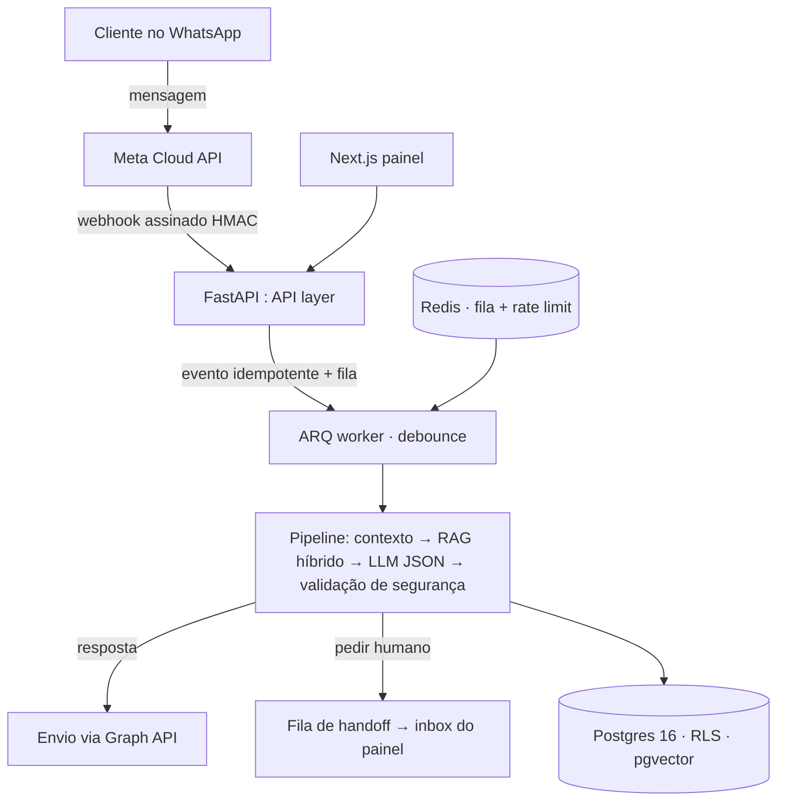

# WAppAI — SaaS de atendimento comercial via WhatsApp com IA (portfólio)

> **Portfólio técnico de Pedro Souza / Lumix Soluções** — engenharia full-stack + IA aplicada.
> **Este repositório é uma vitrine.** O código-fonte completo é proprietário (ver
> [LICENSE](./LICENSE.md)) — aqui estão arquitetura, decisões de engenharia, métricas
> e evidências de funcionamento real em produção-like.

[](./LICENSE.md)
[]()
[]()
[]()
[]()

*(adicione link de vídeo/demo aqui)*

---

## TL;DR

Multi-tenant SaaS que atende clientes no WhatsApp com IA **(RAG + ferramentas de
negócio + handoff humano)**, com base de conhecimento do próprio negócio,
isolamento por tenant no banco, e operação comprovada com **número comercial real**
(WhatsApp Cloud API) respondendo clientes reais.

| Área | Stack |
|---|---|
| Backend | FastAPI (Python 3.12) com worker ARQ — camada API/application/domain/infra |
| Banco | PostgreSQL 16 + **pgvector** (RAG híbrido) + **RLS multi-tenant** |
| IA | LLM OpenAI-compatible (Groq/OpenAI/OpenCode) com JSON estruturado + **anti-alucinação** |
| Frontend | Next.js 14 (App Router) — inbox, handoffs, CRM, catálogo, RAG, settings |
| Infra | Docker Compose (dev/prod), TLS, backups automáticos, worker de fila |
| Qualidade | 93+ unit tests (~6 s) + integração dockerizada + CI (lint→tipos→testes→build) |

## Arquitetura



## Destaques técnicos

- **Isolamento multi-tenant real**: PostgreSQL Row-Level Security por organização —
  provado com testes de cross-tenant na API **E** no banco (404 / violação de policy)
- **RAG híbrido**: pgvector (semântico) × tsquery lexical (full-text) fundidos com
  **RRF** (reciprocal rank fusion); chunking por parágrafos; ingestão de PDF/DOCX/TXT/sites
- **Anti-alucinação**: alegações sensíveis (preço/prazo/estoque) exigem base
  recuperada — sem base, o agente **responde honestamente e oferece handoff**;
  validação de resposta é uma camada própria (leak scan + claims scan)
- **Pipeline WhatsApp à prova de rede**: idempotência por `external_message_id`,
  HMAC opcional, debounce agregando mensagens, flush **após commit** (bug real de
  MVCC capturado e coberto por testes)
- **Credenciais por conta criptografadas** (Fernet, chave derivada de DEVICE_SECRET):
  troca de token de WhatsApp não expõe credenciais
- **Handoff humano de ponta a ponta**: fila idempotente, claim, resolução,
  reativação automática da IA
- **Operação real**: playbook de onboarding de clientes, runbook operacional,
  migrações e seed idempotentes

## Evidências (produção-like com número comercial)

- Mensagem de cliente real → resposta contextual do catálogo em **~1,5 s**
- Fila de handoff populada quando o cliente pede humano (sem alucinar preço)
- Painel operando: inbox, filas, CRM, catálogo, RAG, configurações
- Métricas coletadas por chamada LLM (tokens, custo, latência) — fundação de billing

*(substitua por screenshots reais — ver `screenshots/`)*

## Trechos escolhidos (o código completo é privado)

<details>
<summary>Contrato de saída do agente (JSON estruturado)</summary>

```json
{
  "response": "string — texto configurado por personalidade da org",
  "handoff": false,
  "handoff_reason": null,
  "memory_updates": [],
  "intent": "vendas | suporte | agendamento | atendimento"
}
```

Erro de JSON do LLM → **fallback seguro** (resposta honesta + handoff), nunca envio
de texto livre não validado para o cliente.
</details>

<details>
<summary>Robustez do pipeline (o que os testes cobrem)</summary>

- dedupe de webhook por evento externo (UNIQUE + estado processed)
- flush de debounce enfileirado **só após commit** (consistência MVCC)
- re-scope de RLS/GUC após commit no webhook (multi-tenant)
- fallback de provider documentado — e jamais silencioso em produção (monitorado)
- rate limit com **fail-open audível** (Redis down ≠ atendimento parado)
</details>

## Docs públicas

- [Arquitetura](./docs-public/ARCHITECTURE.md)
- [Integração WhatsApp (Cloud API)](./docs-public/WHATSAPP.md) — com o diário de "pegadinhas" reais
- [Providers de LLM](./docs-public/LLM-PROVIDERS.md) — qualquer API OpenAI-compatible
- [Segurança](./docs-public/SECURITY.md) · [LGPD](./docs-public/LGPD.md) · [Status](./docs-public/STATUS.md)

## Histórias de engenharia (o que aprender fazendo)

1. **MVCC/scheduler**: flush de resposta enfileirado após o commit — senão o worker
   não vê as mensagens pendentes (bug de timing real, coberto por teste)
2. **redis-py v5**: `redis.time()` retorna **tupla** — `int(tuple)` quebra o rate
   limiter em produção (fail-open salvou o turno; fix + revisão de contratos)
3. **Constraints + soft delete**: recriar a mesma conta de WhatsApp sob
   `UNIQUE(org, phone)` com soft-delete exige precedência (o playbook documenta
   os dois caminhos)
4. **Testes nunca chamam LLM real**: um stub determinístico de engine — senão o
   texto flutuante quebra CI (e vira custo)

---

## © Licença

Código-fonte completo: **proprietário** — uso comercial/revenda exige contrato.
Este repo documenta a implementação para avaliação de habilidades.
Ver [LICENSE.md](./LICENSE.md).

## Contato

**Pedro Souza** — Lumix Soluções (BH) · [GitHub](https://github.com/Pedrovisk19) · contato@lumix.com.br
> Disponível para implantação (white-label), consultoria e contratos comerciais.
